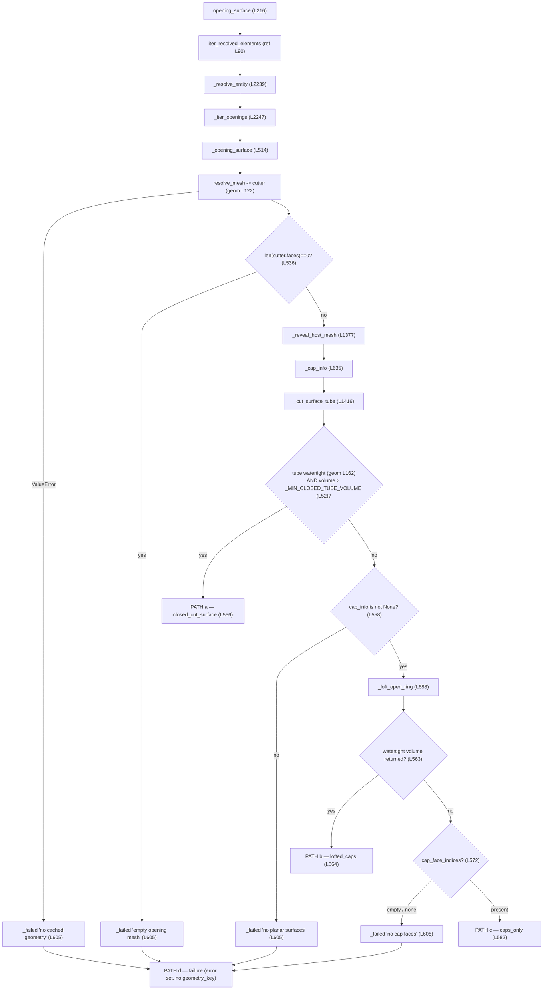
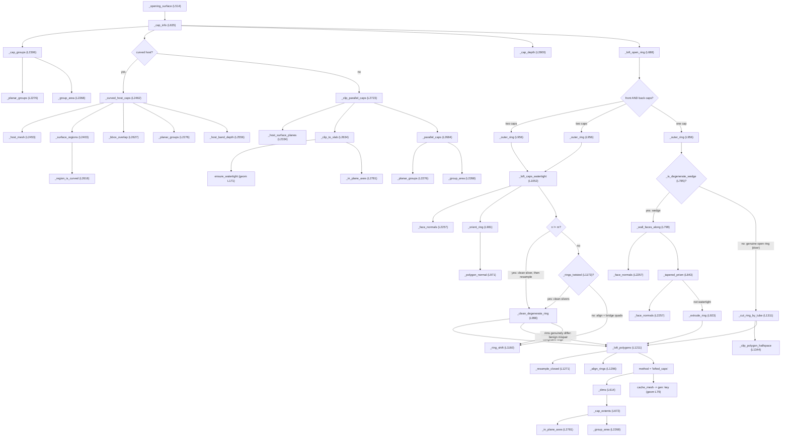
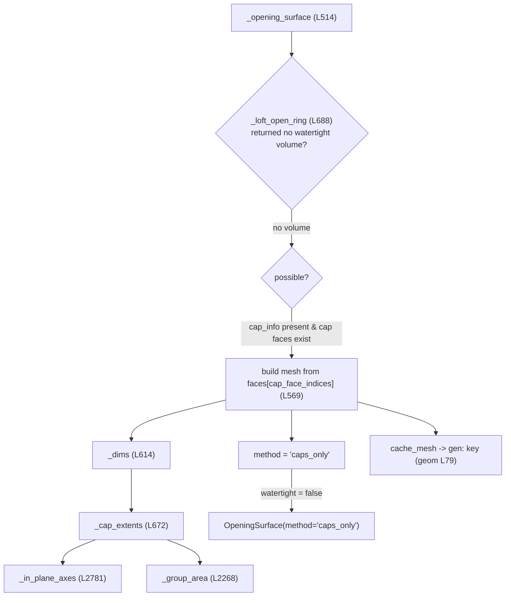
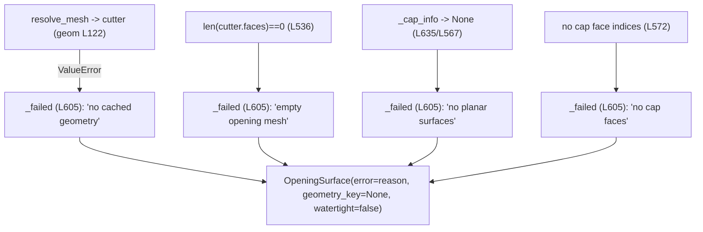

# `opening_surface` — process overview

This document maps the run-time process of the `opening_surface` node
(`app/runner/src/openbim_runner/nodes/opening_surface/opening_surface.py`)
and shows the different paths an opening can take, with the functions each path
calls. Line numbers reference that file unless noted otherwise:

- `geom` = `app/runner/src/openbim_runner/util/geometry.py`
- `ref` = `app/runner/src/openbim_runner/util/references.py`

Each opening resolves to exactly one result, with `method` one of
`closed_cut_surface`, `lofted_caps`, or `caps_only`, or a failure entry (`error`
set, `geometry_key = None`).

## Route map (shared preamble)

The preamble shows how an opening is routed to one of four paths. The terminal
nodes cross-link to the per-path diagrams below.



- **PATH a — `closed_cut_surface`** → [Per-path diagram](#path-a--closed_cut_surface)
- **PATH b — `lofted_caps`** → [Per-path diagram](#path-b--lofted_caps)
- **PATH c — `caps_only`** → [Per-path diagram](#path-c--caps_only)
- **PATH d — failure** → [Per-path diagram](#path-d--failure-no-geometry_key)

### Where each split happens (in `_opening_surface`, L514)

- **Path a** is decided first: the cut-surface tube must be watertight *and*
  enclose real volume (the `_MIN_CLOSED_TUBE_VOLUME = 1e-6` guard at L52 rejects
  the degenerate zero-volume "pillow"; L549–541). Only then `_close_tube_rings`
  re-closes the bore instead of keeping the centroid-fan closure.
- **Path b** is reachable only when Path a's gate fails *and* `cap_info` is not
  `None` (L558) — the opening exposes analysable cap faces. `_loft_open_ring`
  must return a watertight solid (L563).
- **Path c** is the degraded fallback: `cap_info` exists but lofting failed, yet
  cap face indices still exist (L572) → geometry emitted unchanged,
  `watertight = false`.
- **Path d** is every early-exit that returns `_failed (L605)`: `no cached
  geometry`, `empty opening mesh`, `no planar surfaces`, `no cap faces`.

---

## Path a — `closed_cut_surface`

A through-bore / window with planar rims. The host's cut-surface tube is built
and closed; when it closes watertight it is emitted unchanged.

```mermaid
flowchart TD
    P["_opening_surface (L514)"] --> M["_cut_surface_tube (L1416)"]
    M --> N["_face_normals (L2257)"]
    M --> O["_planar_groups (L2276)"]
    O --> P1["_planar_surface (L1495)"]
    P1 --> P2["_mean_normal (L1486)"] & P3["_in_plane_axes (L2781)"] & P4["_project_footprint (L1520)"]
    M --> Q["_footprint_contained (L1532)"]
    M --> R["_close_bore (L1552)"]

    R --> R1["_weld_rim (L1612)"] --> R1a["_weld_positions (L1644)"]
    R --> R2["_prune_flaps (L1692)"]
    R --> R3["_boundary_loops (L1755)"]
    R --> R4["_cap_loops (L1799)"]
    R4 --> R4a["_build_closed (L1852)"]
    R4a --> R4b["_loop_cap_groups (L2124)"]
    R4b --> R4c["_loop_is_planar (L2194)"]
    R4b --> R4d["_host_surface_planes (L2334)"]
    R4b --> R4e["_plane_is_reveal (L2174)"]
    R4b --> R4f["_order_loop_group (L2204)"] --> R4g["_polygon_area (L2227)"]
    R4a --> R4h["_add_cap_fan (L1912)"] & R4i["_edge_key (L1938)"]
    R --> R5["_close_open_ring (L1944)"]  %% single non-planar loop -> open ring, NOT watertight (falls to b)

    M --> G1{"tube watertight (geom L162)\nAND volume > _MIN_CLOSED_TUBE_VOLUME (L52)?"}
    G1 -- "no" --> PATHB["-> Path b"]
    G1 -- "yes" --> S["_close_tube_rings (L321)"]

    S --> S0["_select_cut_faces (L270)"]
    S --> S1["_weld_rim (L1612)"] & S2["_prune_flaps (L1692)"] & S3["_boundary_loops (L1755)"]
    S --> S4["_build_ring_closed (L373)"]
    S4 --> S5["_ring_cap_groups (L413)"]
    S5 --> S5a["_ring_has_axial_edge (L437)"]
    S5 --> S5b["_jogged_ring_groups (L450)"]
    S5 --> S5c["_loop_cap_groups (L2124)"]
    S4 --> S6["_add_cap_fan (L1912)"] & S7["_edge_key (L1938)"]

    S --> OUT["method = 'closed_cut_surface'"]

    OUT --> D1["_dims (L614)"]
    D1 --> D1a["_cap_extents (L672)"] --> D1a1["_in_plane_axes (L2781)"] & D1a2["_group_area (L2268)"]
    D1 --> D1b["_cap_depth (L2800)"]
    D1 --> D1c["_cap_groups (L2306)"]  %% only when cap_info is None
    OUT --> CACHE["cache_mesh -> gen: key (geom L79)"]
```

## Path b — `lofted_caps`

An open ring (door / non-planar rim / curved host). The cut-surface tube stays
open; the opening's cap faces are analysed from the host surface planes instead,
then lofted (connected by new side faces between corresponding boundary points
in 3D) into a watertight solid. `_cap_info`'s curved-host and clip branches are
expanded here because they are decisive for this path.



## Path c — `caps_only`

No watertight volume can be built. The cap/tube geometry is emitted unchanged
(`watertight = false`); no fabricated geometry is produced.



## Path d — failure (no `geometry_key`)

Every early-exit that returns `_failed (L605)`. No geometry is cached; `error`
is set and `watertight = false`.



---

## Full function index (line numbers)

| Function | Line |
|---|---|
| `opening_surface` (async, node entry) | 216 |
| `_select_cut_faces` | 270 |
| `_close_tube_rings` | 321 |
| `_build_ring_closed` | 373 |
| `_ring_cap_groups` | 413 |
| `_ring_has_axial_edge` | 437 |
| `_jogged_ring_groups` | 450 |
| `_opening_surface` | 514 |
| `_failed` | 605 |
| `_dims` | 614 |
| `_cap_info` | 635 |
| `_cap_extents` | 672 |
| `_loft_open_ring` | 688 |
| `_is_degenerate_wedge` | 785 |
| `_wall_faces_along` | 799 |
| `_tapered_prism` | 843 |
| `_extrude_ring` | 923 |
| `_outer_ring` | 956 |
| `_polygon_normal` | 971 |
| `_orient_ring` | 981 |
| `_clean_degenerate_ring` | 998 |
| `_loft_caps_watertight` | 1052 |
| `_ring_shift` | 1160 |
| `_rings_twisted` | 1173 |
| `_loft_polygons` | 1211 |
| `_resample_closed` | 1271 |
| `_align_rings` | 1296 |
| `_cut_ring_by_tube` | 1311 |
| `_clip_polygon_halfspace` | 1344 |
| `_reveal_host_mesh` | 1377 |
| `_cut_surface_tube` | 1416 |
| `_mean_normal` | 1486 |
| `_planar_surface` | 1495 |
| `_project_footprint` | 1520 |
| `_footprint_contained` | 1532 |
| `_close_bore` | 1552 |
| `_weld_rim` | 1612 |
| `_weld_positions` | 1644 |
| `_prune_flaps` | 1692 |
| `_edge_use_counts` | 1747 |
| `_boundary_loops` | 1755 |
| `_cap_loops` | 1799 |
| `_build_closed` | 1852 |
| `_add_cap_fan` | 1912 |
| `_edge_key` | 1938 |
| `_close_open_ring` | 1944 |
| `_ring_cap_chains` | 1997 |
| `_plane_runs` | 2028 |
| `_add_ring_caps` | 2058 |
| `_add_chain_fan` | 2092 |
| `_loop_cap_groups` | 2124 |
| `_plane_is_reveal` | 2174 |
| `_loop_is_planar` | 2194 |
| `_order_loop_group` | 2204 |
| `_polygon_area` | 2227 |
| `_resolve_entity` | 2239 |
| `_iter_openings` | 2247 |
| `_face_normals` | 2257 |
| `_group_area` | 2268 |
| `_planar_groups` | 2276 |
| `_cap_groups` | 2306 |
| `_host_surface_planes` | 2334 |
| `_surface_regions` | 2403 |
| `_host_mesh` | 2453 |
| `_curved_host_caps` | 2462 |
| `_host_band_depth` | 2556 |
| `_region_is_curved` | 2616 |
| `_bbox_overlap` | 2627 |
| `_clip_to_slab` | 2634 |
| `_parallel_caps` | 2684 |
| `_clip_parallel_caps` | 2723 |
| `_in_plane_axes` | 2781 |
| `_cap_depth` | 2800 |

Shared helpers referenced from `util/geometry.py`: `build_geometry_cache` (L25),
`cache_mesh` (L79), `resolve_mesh` (L122), `_is_watertight` (L162),
`ensure_watertight` (L171), `reshape_flat` (L202). From `util/references.py`:
`expr_key` (L36), `split_expr_key` (L41), `iter_resolved_elements` (L90),
`parse_element_ref` (L70), `split_reference` (L109).
