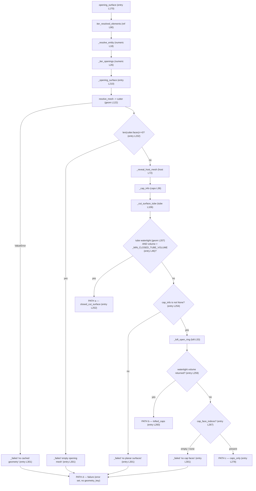
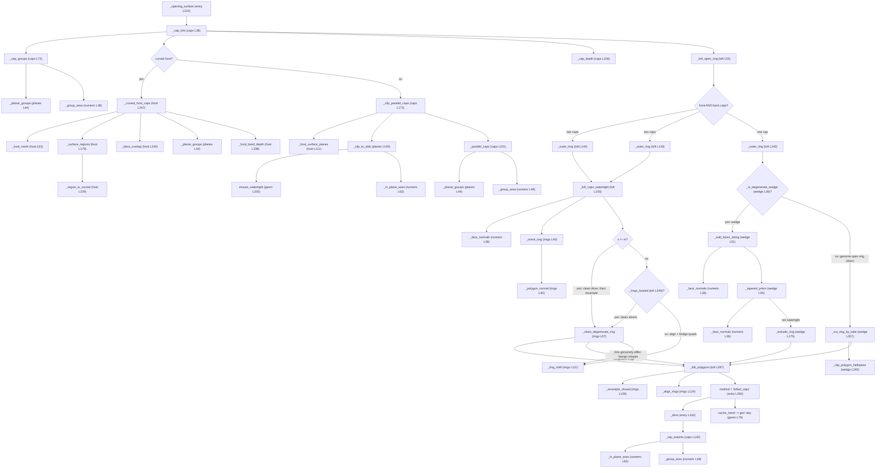
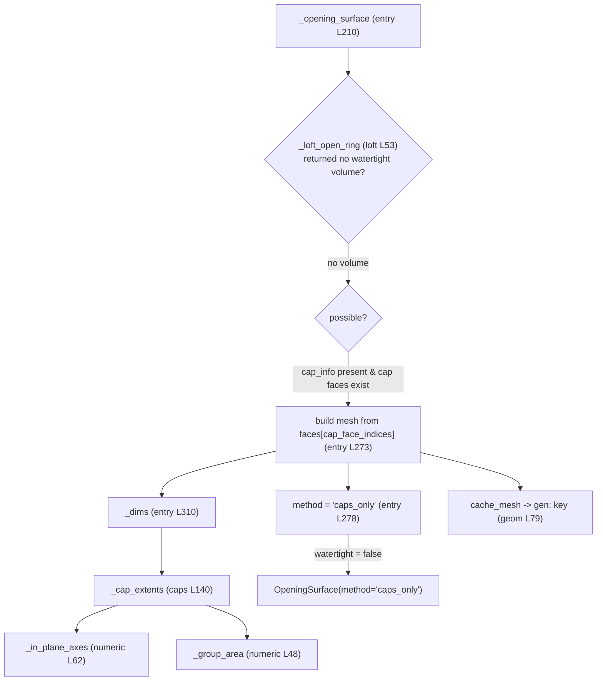
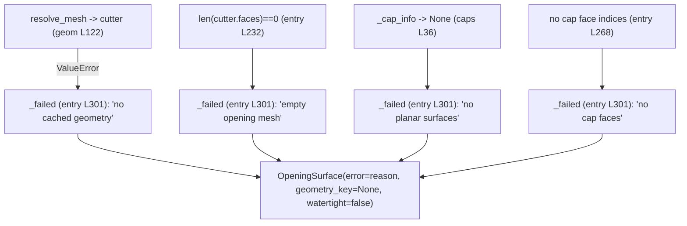

# `opening_surface` — process overview

This document maps the run-time process of the `opening_surface` node
(`app/runner/src/rcc4all_runner/nodes/opening_surface/`) and shows the
different paths an opening can take, with the functions each path calls. Every function below is annotated with the module and line it lives in. Line numbers reference that file unless noted otherwise:

- `entry`   = `opening_surface.py`
- `caps`    = `_caps.py` — opening cap-face analysis
- `host`    = `_host_surface.py` — host-surface analysis
- `planes`  = `_planes.py` — planar grouping, footprint containment, slab clipping
- `numeric` = `_numeric.py` — numeric helpers
- `tube`    = `_tube.py` — cut-surface tube selection and jogged-ring closure
- `bore`    = `_bore_closure.py` — bore closing
- `ringcaps`= `_ring_caps.py` — per-plane cap decomposition and open-ring capping
- `topo`    = `_mesh_topology.py` — mesh topology helpers
- `loft`    = `_loft.py` — ring pairing, twist detection and lofting
- `rings`   = `_rings.py` — cap-ring utilities
- `wedge`   = `_wedge.py` — degenerate-wedge handling and tube ring clipping

Shared helpers live outside this folder:

- `geom` = `app/runner/src/rcc4all_runner/util/geometry.py`
- `ref`  = `app/runner/src/rcc4all_runner/util/references.py`

Each opening resolves to exactly one result, with `method` one of
`closed_cut_surface`, `lofted_caps`, or `caps_only`, or a failure entry (`error`
set, `geometry_key = None`).

## Route map (shared preamble)

The preamble shows how an opening is routed to one of four paths. The terminal
nodes cross-link to the per-path diagrams below.



- **PATH a — `closed_cut_surface`** → [Per-path diagram](#path-a--closed_cut_surface)
- **PATH b — `lofted_caps`** → [Per-path diagram](#path-b--lofted_caps)
- **PATH c — `caps_only`** → [Per-path diagram](#path-c--caps_only)
- **PATH d — failure** → [Per-path diagram](#path-d--failure-no-geometry_key)

### Where each split happens (in `_opening_surface`, entry L210)

- **Path a** is decided first: the cut-surface tube must be watertight *and*
  enclose real volume (the `_MIN_CLOSED_TUBE_VOLUME = 1e-6` guard at entry L46
  rejects the degenerate zero-volume "pillow"; entry L245–249). Only then
  `_close_tube_rings` (tube L175) re-closes the bore instead of keeping the
  centroid-fan closure.
- **Path b** is reachable only when Path a's gate fails *and* `cap_info` is not
  `None` (entry L254) — the opening exposes analysable cap faces. `_loft_open_ring`
  (loft L53) must return a watertight solid (entry L259–260).
- **Path c** is the degraded fallback: `cap_info` exists but lofting failed, yet
  cap face indices still exist (entry L267) → geometry emitted unchanged,
  `watertight = false`.
- **Path d** is every early-exit that returns `_failed` (entry L301): `no cached
  geometry`, `empty opening mesh`, `no planar surfaces`, `no cap faces`.

---

## Path a — `closed_cut_surface`

A through-bore / window with planar rims. The host's cut-surface tube is built
and closed; when it closes watertight it is emitted unchanged.

```mermaid
flowchart TD
    P["_opening_surface (entry L210)"] --> M["_cut_surface_tube (tube L106)"]
    M --> N["_face_normals (numeric L36)"]
    M --> O["_planar_groups (planes L44)"]
    O --> P1["_planar_surface (planes L83)"]
    P1 --> P2["_mean_normal (planes L74)"] & P3["_in_plane_axes (numeric L62)"] & P4["_project_footprint (planes L108)"]
    M --> Q["_footprint_contained (planes L120)"]
    M --> R["_close_bore (bore L32)"]

    R --> R1["_weld_rim (topo L82)"] --> R1a["_weld_positions (topo L108)"]
    R --> R2["_prune_flaps (topo L154)"]
    R --> R3["_boundary_loops (topo L38)"]
    R --> R4["_cap_loops (bore L87)"]
    R4 --> R4a["_build_closed (bore L145)"]
    R4a --> R4b["_loop_cap_groups (ringcaps L98)"]
    R4b --> R4c["_loop_is_planar (ringcaps L38)"]
    R4b --> R4d["_host_surface_planes (host L111)"]
    R4b --> R4e["_plane_is_reveal (ringcaps L78)"]
    R4b --> R4f["_order_loop_group (ringcaps L55)"] --> R4g["_polygon_area (ringcaps L48)"]
    R4a --> R4h["_add_cap_fan (bore L205)"] & R4i["_edge_key (topo L24)"]
    R --> R5["_close_open_ring (ringcaps L148)"]  %% single non-planar loop -> open ring, NOT watertight (falls to b)

    M --> G1{"tube watertight (geom L207)\nAND volume > _MIN_CLOSED_TUBE_VOLUME (entry L46)?"}
    G1 -- "no" --> PATHB["-> Path b"]
    G1 -- "yes" --> S["_close_tube_rings (tube L175)"]

    S --> S0["_select_cut_faces (tube L55)"]
    S --> S1["_weld_rim (topo L82)"] & S2["_prune_flaps (topo L154)"] & S3["_boundary_loops (topo L38)"]
    S --> S4["_build_ring_closed (tube L227)"]
    S4 --> S5["_ring_cap_groups (tube L267)"]
    S5 --> S5a["_ring_has_axial_edge (tube L291)"]
    S5 --> S5b["_jogged_ring_groups (tube L304)"]
    S5 --> S5c["_loop_cap_groups (ringcaps L98)"]
    S4 --> S6["_add_cap_fan (bore L205)"] & S7["_edge_key (topo L24)"]

    S --> OUT["method = 'closed_cut_surface' (entry L252)"]

    OUT --> D1["_dims (entry L310)"]
    D1 --> D1a["_cap_extents (caps L140)"] --> D1a1["_in_plane_axes (numeric L62)"] & D1a2["_group_area (numeric L48)"]
    D1 --> D1b["_cap_depth (caps L156)"]
    D1 --> D1c["_cap_groups (caps L73)"]  %% only when cap_info is None
    OUT --> CACHE["cache_mesh -> gen: key (geom L79)"]
```

## Path b — `lofted_caps`

An open ring (door / non-planar rim / curved host). The cut-surface tube stays
open; the opening's cap faces are analysed from the host surface planes instead,
then lofted (connected by new side faces between corresponding boundary points
in 3D) into a watertight solid. `_cap_info`'s curved-host and clip branches are
expanded here because they are decisive for this path.



## Path c — `caps_only`

No watertight volume can be built. The cap/tube geometry is emitted unchanged
(`watertight = false`); no fabricated geometry is produced.



## Path d — failure (no `geometry_key`)

Every early-exit that returns `_failed` (entry L301). No geometry is cached; `error`
is set and `watertight = false`.



---

## Full function index (file, line)

| Function | File | Line |
|---|---|---|
| `opening_surface` (async, node entry) | opening_surface.py | 170 |
| `_select_cut_faces` | _tube.py | 55 |
| `_close_tube_rings` | _tube.py | 175 |
| `_build_ring_closed` | _tube.py | 227 |
| `_ring_cap_groups` | _tube.py | 267 |
| `_ring_has_axial_edge` | _tube.py | 291 |
| `_jogged_ring_groups` | _tube.py | 304 |
| `_opening_surface` | opening_surface.py | 210 |
| `_failed` | opening_surface.py | 301 |
| `_dims` | opening_surface.py | 310 |
| `_cap_info` | _caps.py | 36 |
| `_cap_extents` | _caps.py | 140 |
| `_loft_open_ring` | _loft.py | 53 |
| `_is_degenerate_wedge` | _wedge.py | 36 |
| `_wall_faces_along` | _wedge.py | 51 |
| `_tapered_prism` | _wedge.py | 95 |
| `_extrude_ring` | _wedge.py | 175 |
| `_outer_ring` | _loft.py | 140 |
| `_polygon_normal` | _rings.py | 30 |
| `_orient_ring` | _rings.py | 40 |
| `_clean_degenerate_ring` | _rings.py | 57 |
| `_loft_caps_watertight` | _loft.py | 155 |
| `_ring_shift` | _rings.py | 111 |
| `_rings_twisted` | _loft.py | 249 |
| `_loft_polygons` | _loft.py | 287 |
| `_resample_closed` | _rings.py | 139 |
| `_align_rings` | _rings.py | 124 |
| `_cut_ring_by_tube` | _wedge.py | 207 |
| `_clip_polygon_halfspace` | _wedge.py | 240 |
| `_reveal_host_mesh` | _host_surface.py | 72 |
| `_cut_surface_tube` | _tube.py | 106 |
| `_mean_normal` | _planes.py | 74 |
| `_planar_surface` | _planes.py | 83 |
| `_project_footprint` | _planes.py | 108 |
| `_footprint_contained` | _planes.py | 120 |
| `_close_bore` | _bore_closure.py | 32 |
| `_weld_rim` | _mesh_topology.py | 82 |
| `_weld_positions` | _mesh_topology.py | 108 |
| `_prune_flaps` | _mesh_topology.py | 154 |
| `_edge_use_counts` | _mesh_topology.py | 30 |
| `_boundary_loops` | _mesh_topology.py | 38 |
| `_cap_loops` | _bore_closure.py | 87 |
| `_build_closed` | _bore_closure.py | 145 |
| `_add_cap_fan` | _bore_closure.py | 205 |
| `_edge_key` | _mesh_topology.py | 24 |
| `_edge_traversal` | _bore_closure.py | 132 |
| `_close_open_ring` | _ring_caps.py | 148 |
| `_ring_cap_chains` | _ring_caps.py | 198 |
| `_plane_runs` | _ring_caps.py | 228 |
| `_add_ring_caps` | _ring_caps.py | 258 |
| `_add_chain_fan` | _ring_caps.py | 292 |
| `_loop_cap_groups` | _ring_caps.py | 98 |
| `_plane_is_reveal` | _ring_caps.py | 78 |
| `_loop_is_planar` | _ring_caps.py | 38 |
| `_order_loop_group` | _ring_caps.py | 55 |
| `_polygon_area` | _ring_caps.py | 48 |
| `_resolve_entity` | _numeric.py | 18 |
| `_iter_openings` | _numeric.py | 26 |
| `_face_normals` | _numeric.py | 36 |
| `_group_area` | _numeric.py | 48 |
| `_planar_groups` | _planes.py | 44 |
| `_cap_groups` | _caps.py | 73 |
| `_host_surface_planes` | _host_surface.py | 111 |
| `_surface_regions` | _host_surface.py | 179 |
| `_host_mesh` | _host_surface.py | 63 |
| `_curved_host_caps` | _host_surface.py | 247 |
| `_host_band_depth` | _host_surface.py | 338 |
| `_region_is_curved` | _host_surface.py | 229 |
| `_bbox_overlap` | _host_surface.py | 240 |
| `_clip_to_slab` | _planes.py | 140 |
| `_parallel_caps` | _caps.py | 101 |
| `_clip_parallel_caps` | _caps.py | 172 |
| `_in_plane_axes` | _numeric.py | 62 |
| `_cap_depth` | _caps.py | 156 |

Shared helpers referenced from `util/geometry.py`: `build_geometry_cache` (L25),
`cache_mesh` (L79), `resolve_mesh` (L122), `_safe_volume` (L162),
`_safe_fix_normals` (L183), `_is_watertight` (L207), `ensure_watertight` (L220),
`reshape_flat` (L251). From `util/references.py`: `expr_key` (L36),
`split_expr_key` (L41), `iter_resolved_elements` (L90), `parse_element_ref`
(L70), `split_reference` (L109).
